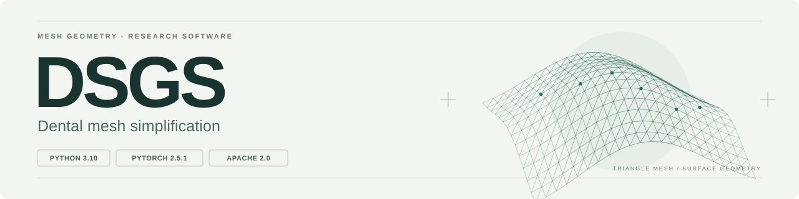

<div align="center">



<h2>Dental Mesh Saliency-Guided Simplification<br />with Geometric Feature Preservation</h2>

**Ke Li · Yutong Hu · Haisheng Li · Li Chen**

Saliency estimation and geometric processing for dental triangle meshes.

[Installation](#installation) &nbsp; · &nbsp;
[Quick start](#quick-start) &nbsp; · &nbsp;
[Configuration](#configuration) &nbsp; · &nbsp;
[Code](#repository-structure) &nbsp; · &nbsp;
[Citation](#citation)

</div>

---

## Installation

Use **Python 3.10** and install the **PyTorch 2.5.1** build appropriate for your
hardware. Then install the dependencies:

```bash
python -m pip install -r requirements.txt
```

<details>
<summary><strong>CPU installation</strong></summary>

```bash
python -m pip install torch==2.5.1 --index-url https://download.pytorch.org/whl/cpu
python -m pip install -r requirements.txt
```

</details>

The code has been checked on Windows. PyMeshLab and Open3D may require
platform-specific system libraries on other systems.

## Quick start

Provide a triangle mesh, then train and simplify it with a single command:

```bash
python main.py -i data/your_mesh.stl -o output/DSGS_50.obj -r 0.5 --device auto
```

> **Face retention** · `-r 0.5` requests approximately **50% of the cleaned input
> faces**. The target has a 500-face minimum, capped at the original face count.
> Boundary and quality constraints may affect the actual budget.

The height feature assumes **positive z points toward the occlusal surface**.
Coordinates are not rescaled; use a consistent orientation and verify the
physical units of your input data. Each input mesh is trained independently.

### Reuse a checkpoint

Train once and reuse the checkpoint for another face budget on the same mesh:

```bash
python main.py -i data/your_mesh.stl -o output/DSGS_30.obj -r 0.3 --checkpoint output/DSGS_50.pth --device auto
```

Saved patch settings and the seed are restored from the checkpoint. The face
retention ratio and device remain selectable. Choose a new output stem to
preserve the previous run's metadata.

<details>
<summary><strong>Short execution check</strong></summary>

Use a sufficiently dense input mesh with reduced training settings:

```bash
python main.py -i data/your_mesh.stl -o output/check.obj -r 0.5 --device cpu --epochs 1 --patch-points 128 --num-patches 2
```

These settings check the software path. Use the default configuration for normal
experiments.

</details>

## Configuration

| Option | Default | Purpose |
| :--- | :---: | :--- |
| `--ratio`, `-r` | `0.1` | Fraction of faces retained, in `(0, 1]` |
| `--device`, `-d` | `auto` | Select `auto`, `cpu` or `cuda` |
| `--epochs` | `100` | Training epochs per input mesh |
| `--num-patches` | `16` | Number of candidate patches |
| `--patch-points` | `4096` | Sampled points per patch |
| `--seed` | `42` | Random seed |
| `--checkpoint` | — | Load a checkpoint and skip training |

Defaults are defined in [config.py](config.py). For all command-line options:

```bash
python main.py --help
```

## Repository structure

| File | Role |
| :--- | :--- |
| [main.py](main.py) | Training and simplification entry point |
| [model.py](model.py) | Saliency network |
| [loss.py](loss.py) | Training objectives |
| [config.py](config.py) | Default configuration |
| [utils_geo.py](utils_geo.py) | Geometric features and patch processing |
| [runtime.py](runtime.py) | Mesh loading, seeds and input validation |
| [simplify.py](simplify.py) | Mesh decimation |
| [surface_refinement.py](surface_refinement.py) | Surface fitting |

## Outputs

For `--output output/DSGS_50.obj`, the run produces:

| Artifact | Contents |
| :--- | :--- |
| `DSGS_50.obj` | Simplified mesh |
| `DSGS_50.pth` | Trained checkpoint, when training is performed |
| `DSGS_50_weights.npz` | Stitched vertex saliency and curvature |
| `DSGS_50.json` | Configuration, versions, hashes, face counts and timing |

<details>
<summary><strong>Geometry and repeatability notes</strong></summary>
The fused vertex saliency weights modulate QEM edge-collapse costs through a protection factor determined by the target face-retention ratio. Valid edge collapses are ranked by the weighted cost and applied iteratively until the target face budget is reached. Record the actual face count and configuration when
reporting results. Fixed seeds support repeated runs; numerical results may
still vary with hardware and dependency versions.

## License

Released under the [Apache License 2.0](LICENSE). Third-party dependencies retain
their respective licenses.
